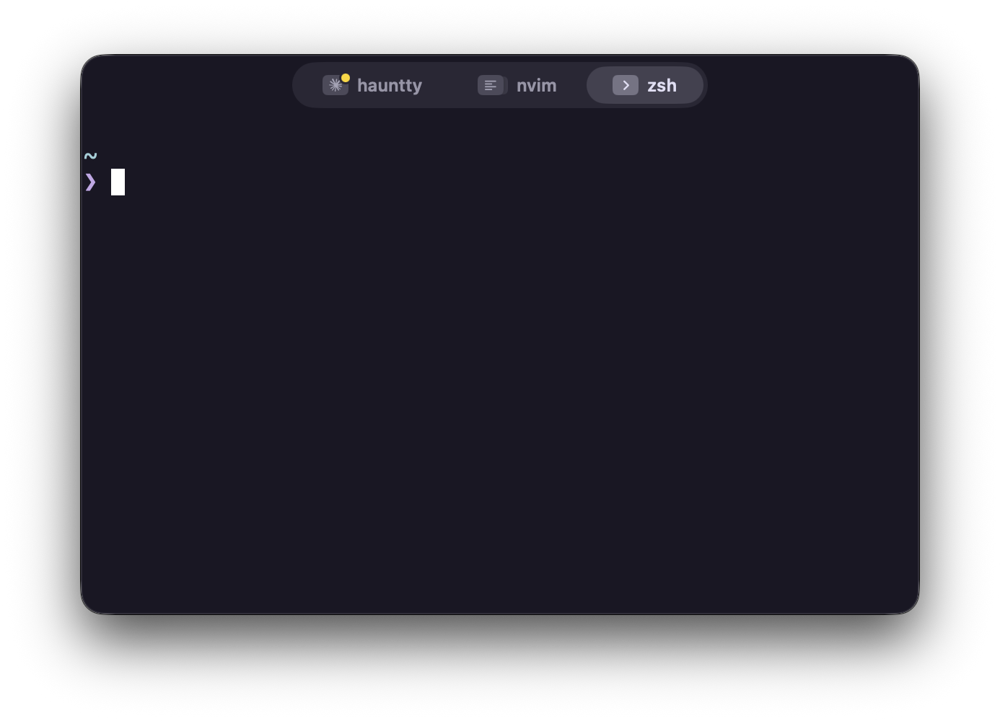

# hauntty

hauntty is a macOS terminal for working in tmux with agents. It is built
on libghostty so it renders and reads its config the way Ghostty does.



## Why it exists

I wanted a daily driver that works well with coding agents. Agents such as
Claude Code run for minutes at a time, and I usually have several going in
different tmux windows. What I need to know is which window needs me: which
agent has finished, which is waiting for an answer and which has failed.

hauntty shows that in the tab bar. Each tab has a dot for its window's state:
working, done, blocked or error. A state that asks for attention stays until
you look at the tab.

## How it works

Each window holds one libghostty surface that runs
`tmux new-session -A -s hauntty`. tmux draws the splits, borders and copy
mode, as it does in any terminal.

A second tmux client runs next to it in control mode,
`tmux -C attach-session -f ignore-size,no-output`, and drives the tab bar:

- It finds the terminal's tmux client by its tty and switches to that
  client's session. `%client-session-changed` moves it along when you switch
  sessions.
- Notifications such as `%window-add`, `%window-close` and
  `%window-pane-changed` reload the window list with `list-windows`.
- Two `refresh-client -B` subscriptions report what has no notification: each
  window's index, `@state` and name, and each pane's process and title. tmux
  checks them at most once a second.
- Clicking a tab sends `select-window`.

A tab's dot comes from two places. Any program can set the `@state` window
option, for example `tmux set -w @state working`, to `idle`, `working`,
`done`, `blocked` or `error`, the states of the
[OSC 7501 proposal](https://mitchellh.com/writing/program-status-osc7501).

Claude Code can switch between sessions in one pane, so its states are kept
per session instead: `scripts/hauntty.sh` writes one line per session to
`$TMPDIR/hauntty/claude-sessions`, and a tab shows the sessions its Claude
Code panes show. When several states apply, the tab shows the most urgent
one. hauntty clears a `done` window option when you switch to the tab, and
removes a `done`, `blocked` or `error` session from the file once you look at
its tab.

hauntty does not use tmux's `-CC` mode with one surface per pane, as iTerm2
does. It would have to lay out the splits itself, and libghostty expects each
surface to own a pty.

## Claude Code integration

Install `jq`, then add `scripts/hauntty.sh` as a hook for these events in
`~/.claude/settings.json`:

```json
{
  "hooks": {
    "UserPromptSubmit": [
      {
        "hooks": [
          {
            "type": "command",
            "command": "/path/to/hauntty/scripts/hauntty.sh"
          }
        ]
      }
    ],
    "PostToolUse": [
      {
        "hooks": [
          {
            "type": "command",
            "command": "/path/to/hauntty/scripts/hauntty.sh",
            "async": true
          }
        ]
      }
    ],
    "PermissionRequest": [
      {
        "hooks": [
          {
            "type": "command",
            "command": "/path/to/hauntty/scripts/hauntty.sh",
            "async": true
          }
        ]
      }
    ],
    "Notification": [
      {
        "hooks": [
          {
            "type": "command",
            "command": "/path/to/hauntty/scripts/hauntty.sh"
          }
        ]
      }
    ],
    "Stop": [
      {
        "hooks": [
          {
            "type": "command",
            "command": "/path/to/hauntty/scripts/hauntty.sh"
          }
        ]
      }
    ],
    "StopFailure": [
      {
        "hooks": [
          {
            "type": "command",
            "command": "/path/to/hauntty/scripts/hauntty.sh"
          }
        ]
      }
    ],
    "SessionEnd": [
      {
        "hooks": [
          {
            "type": "command",
            "command": "/path/to/hauntty/scripts/hauntty.sh"
          }
        ]
      }
    ]
  }
}
```

## Requirements

- macOS 26 or later.
- tmux, from Homebrew or in `/usr/bin`.
- Zig 0.17, which the pinned Ghostty commit needs to build libghostty.
- Xcode, for the Swift 6.2 toolchain and the macOS SDK.
- jq installed.

## Build

```sh
git clone --recurse-submodules https://github.com/kalasjocke/hauntty
cd hauntty
scripts/build-ghosttykit.sh   # builds vendor/GhosttyKit.xcframework
scripts/bundle.sh             # builds build/Hauntty.app
swift test
open build/Hauntty.app
```

`scripts/build-ghosttykit.sh` only needs to run again when the Ghostty
submodule changes. `scripts/bundle.sh debug` makes a debug build.

## Configuration

hauntty reads your Ghostty config from `~/.config/ghostty/config`, and
Ghostty's themes ship in the app bundle. There is no hauntty config file.

Its tab bar replaces the tmux status bar, so hauntty turns the status bar off
for every session it shows. The setting stays on the session afterwards. Turn
it back on with `tmux set status on`.

## License and credits

hauntty is released under the [MIT license](LICENSE).

It embeds [Ghostty](https://github.com/ghostty-org/ghostty) as
libghostty, from a submodule in `vendor/ghostty`. The surface view in
`Sources/Hauntty/Ghostty/SurfaceView.swift` is adapted from
`SurfaceView_AppKit.swift` in Ghostty's macOS app. Ghostty is MIT licensed,
copyright Mitchell Hashimoto and the Ghostty contributors.
